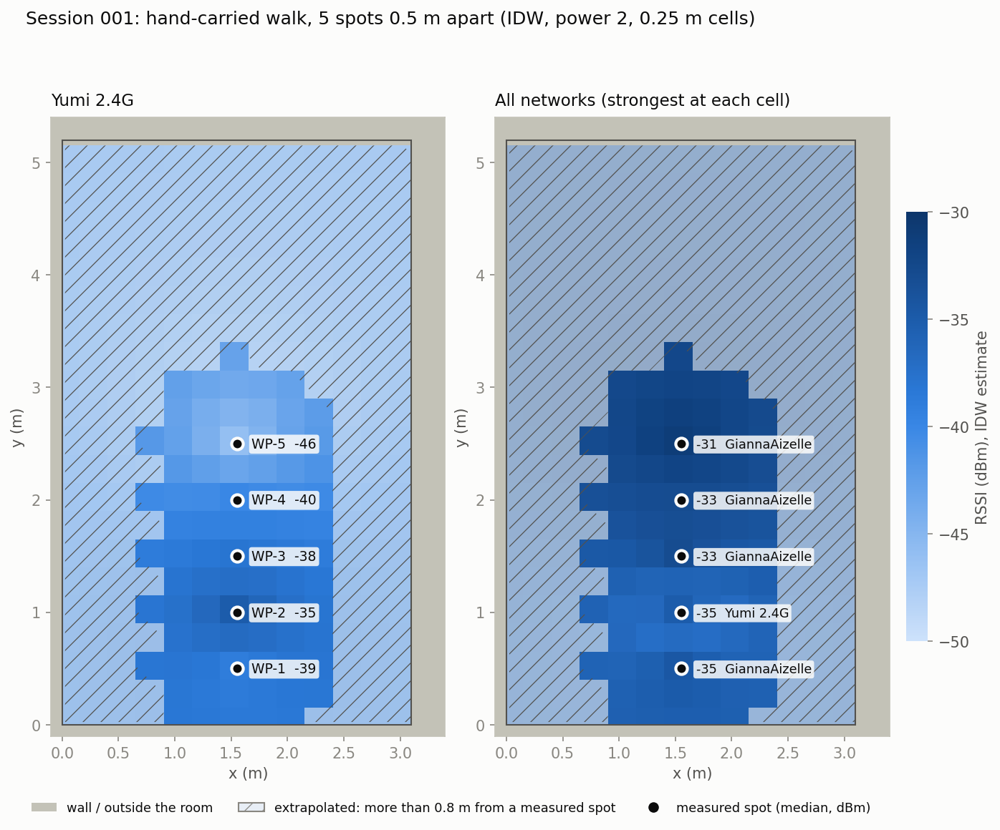

# Session 001: hand-carried walk test

## Setup

| Item | Value |
|---|---|
| Scanner | Raspberry Pi 4B + TP-Link Archer T3U Plus (RTL8812BU) in passive monitor mode, channels 1-11 |
| Room | 3.10 m x 5.21 m (205 in), origin (0, 0) at a corner, +y along the long side |
| Spots | 5 marks on the room's centre line, x = 1.55 m, y = 0.5 to 2.5 m, 0.5 m apart |
| Per spot | Scanner held by hand at about 1 m height, facing +y (heading 90 deg), standing still for 10 s |
| Recording | `walk_survey`: one record per beacon heard, nothing filtered on the Pi |

## Files

| Path | Contents |
|---|---|
| `raw/notification.json` | Session summary: status, start/end time, record count (580), SHA-256 of the records |
| `raw/records.json` | The 580 raw records, exactly as recorded |
| `raw/waypoints.json` | The 5 waypoint definitions (intended positions) |
| `map/map.yaml`, `map/map.pgm` | Map of the room built from its measured size (`make_room_map`), used for the grid |
| `processed/cleaning.json` | Step 6: counts per rejection reason and every rejected record with its reason |
| `processed/merged.json` | Step 7: one median per network (BSSID) per spot, with readings, std, min, max; measured spot positions |
| `processed/sets.json` | Step 8: per-network point sets (strongest BSSID per spot) |
| `processed/grid.json` | Phase C: grid layout (14 x 22 cells of 0.25 m) and the free-floor mask |
| `processed/IDW_<network>.json`, `IDW_ALL.json` | Phase D: IDW estimate for every cell, per network and all-networks (strongest per cell) |
| `processed/summary.json` | What ran, what was skipped and why, the settings used and the map fingerprint |
| `processed/preview_heatmap.png` | The heatmap above |

## Results

- **Transfer checks:** record count (580), SHA-256 and sequence numbers all match the notification.
- **Cleaning:** 268 of 580 records kept. Rejected: 292 heard off-channel, 16 invalid (the adapter's
  fixed -239 dBm value), 4 outliers.
- **Networks:** 15 heard, all WPA2, on channels 1-11. IDW ran for the 11 heard at 3 or more spots.
  Kriging needs at least 20 spots, so it was skipped for every network, as designed.
- **Yumi 2.4G** (median dBm after cleaning, with readings and standard deviation per spot):

  | Spot | WP-1 | WP-2 | WP-3 | WP-4 | WP-5 |
  |---|---|---|---|---|---|
  | RSSI (dBm) | -39.0 | -35.0 | -38.0 | -40.0 | -46.0 |
  | Readings | 11 | 9 | 9 | 11 | 7 |
  | Std (dB) | 2.1 | 0.9 | 1.8 | 2.3 | 2.8 |

  The spread at every spot is within 3 dB.
- **All-networks view:** a neighbouring network (GiannaAizelle) is the strongest at 4 of the 5
  spots; Yumi 2.4G is strongest at WP-2.

## Reproduce

From the repository root, with the robot packages built (Humble, see the top-level README):

    postprocess data/sessions/001/raw --store /tmp/store --map data/sessions/001/map/map.yaml
    heatmap_preview /tmp/store/sessions/001/processed --map data/sessions/001/map/map.yaml \
        --network "Yumi 2.4G"
